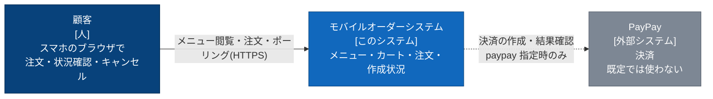
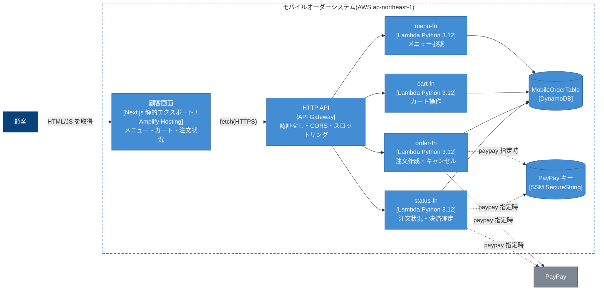
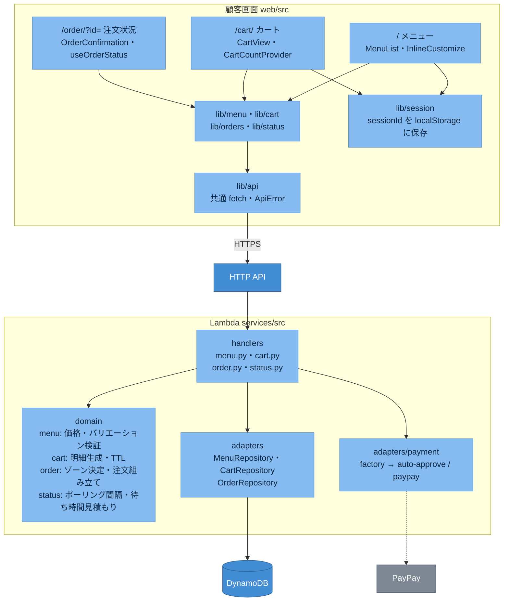
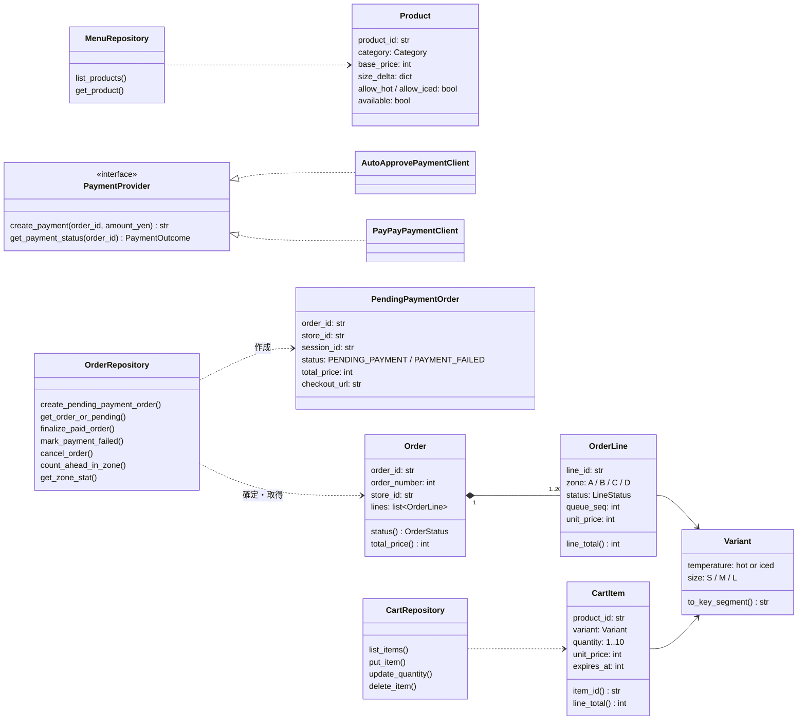
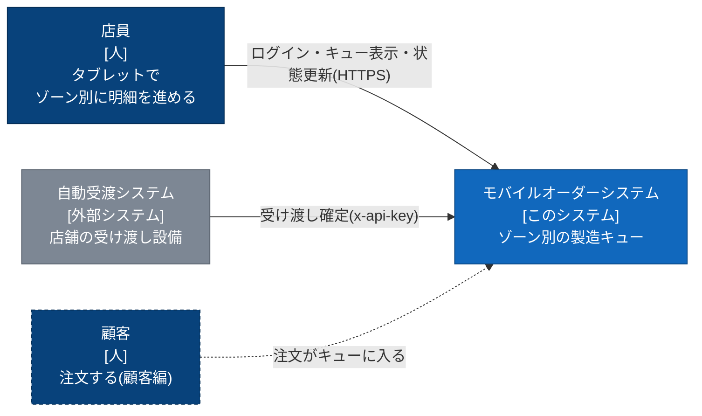
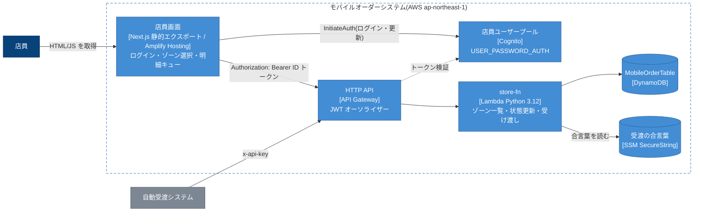
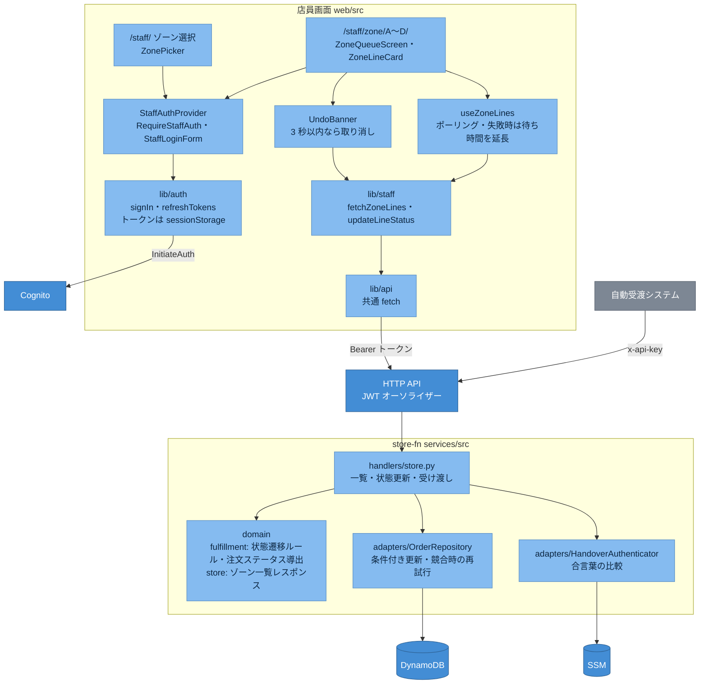
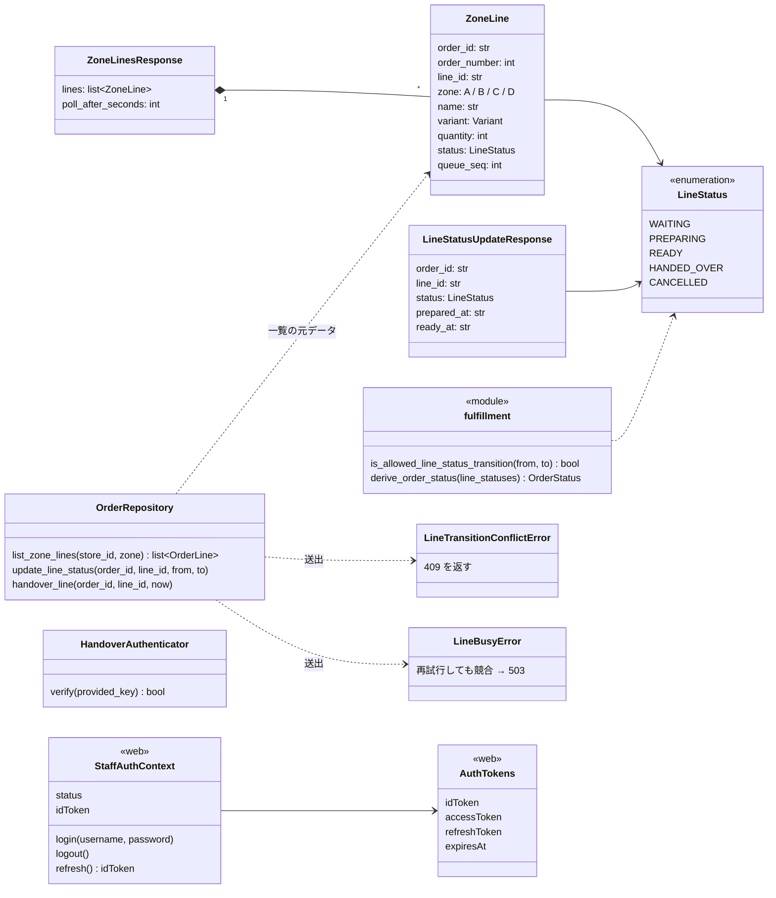

# AWS_OrderSystem C4モデル

カフェ向けモバイルオーダーの現在のアーキテクチャを、**ソースコードだけ**から読み取って描いたものです(設計書 `docs/` は参照していません)。使う人ごとに**顧客編**と**店員編**に分け、それぞれ C4 の Level 1〜4 の図を載せています。

- 対象: `main`(a56f956)
- 作成日: 2026-11-15
- 読んだ範囲: `infra/` `services/src/` `web/src/` `amplify.yml`
- 同じ内容の HTML 版: [`architecture-c4.html`](architecture-c4.html)(ダウンロードしてブラウザで開く)。コードを変えたら両方を更新してください

**図の色の意味**

| 色 | 意味 |
|---|---|
| 濃い紺 | 人 |
| 青 | このシステム |
| 水色 | コンテナ(デプロイ単位) |
| 薄い水色 | コンポーネント(部品) |
| 灰色 | 外部システム |

**目次**

- [顧客編](#顧客編): メニュー → カート → 注文 → 状況確認
- [店員編](#店員編): ログイン → ゾーンのキュー → 状態更新・受け渡し
- [共通](#共通): データの持ち方・デプロイ・気づいた点

---

## 顧客編

お客様がスマホのブラウザでメニューを見て、カートに入れ、注文し、作成状況を確認するまでに関わる部分です。ログインは無く、カートはブラウザが作った ID で識別します。

### Level 1 システムコンテキスト

顧客はシステムだけとやり取りします。決済は PayPay とつなぐ作りになっていますが、既定の設定(`auto-approve`)では外部と通信せず、常に支払い成功として扱います。

### Level 2 コンテナ

画面は Amplify Hosting から静的ファイルとして届き、ブラウザが API Gateway を直接呼びます。顧客向けの API は認証なしで、4 つの Lambda 関数が受け持ちます。

| API | 関数 | 何をするか(コードから) |
|---|---|---|
| `GET /menu` `GET /menu/{productId}` | menu-fn | 商品を読み、並び順を整えて返す |
| `GET /cart/{sessionId}` `POST …/items` `PUT\|DELETE …/items/{itemId}` | cart-fn | 商品とサイズ・温度を検証して明細を追加・変更・削除。更新のたびに期限を 24 時間延長 |
| `POST /orders` `PATCH /orders/{orderId}/cancel` | order-fn | カートとメニューから価格を再計算し、仮注文(`PENDING_PAYMENT`)を作って決済 URL を返す。キャンセルは全明細が未着手のときだけ |
| `GET /orders/{orderId}` `GET /orders/{orderId}/queue-position` | status-fn | 仮注文なら決済結果を確認し、成功なら本注文に確定。状況・待ち順・次のポーリング間隔を返す |

### Level 3 コンポーネント

上半分が画面側(`web/src`)、下半分が Lambda 側(`services/src`)の部品です。Lambda は **handlers**(入口)→ **domain**(AWS に依存しない業務ルール)/ **adapters**(DynamoDB・決済)の 3 層に分かれています。

### Level 4 コード(注文の作成と確定)

顧客の流れで中心になるクラスです。order-fn は `PendingPaymentOrder`(仮注文)を作り、status-fn が決済成功を確認すると `OrderRepository.finalize_paid_order()` で `Order` と `OrderLine`(本注文)に置き換えます。決済は `PaymentProvider` という共通の形に合わせた実装を差し替えて使います。

ゾーンは商品のカテゴリとサイズで決まります(エスプレッソ L→A、M→B、S→C。紅茶とフラッペ→D)。1 注文の明細は最大 20、1 明細の数量は最大 10 です。

---

## 店員編

店員がタブレットでログインし、担当ゾーン(A〜D)のキューを見ながら明細を「作成中」「完成」と進め、店舗の自動受渡システムが受け渡しを確定するまでに関わる部分です。

### Level 1 システムコンテキスト

店員はログインしてシステムを使います。受け渡しの確定は人ではなく、店舗の自動受渡システムが API キーで呼び出します。キューに並ぶ明細は、顧客の注文から作られます。

### Level 2 コンテナ

店員画面は顧客画面と同じ Amplify のサイトにあります。ログインはブラウザが Cognito を直接呼び、受け取った ID トークンを付けて API を呼びます。API Gateway がトークンを検証してから store-fn に渡します。

| API | 認証 | 何をするか(コードから) |
|---|---|---|
| `GET /stores/{storeId}/zones/{zone}/lines` | Cognito JWT | そのゾーンの「待ち」「作成中」の明細を受付順に返す(GSI2。完成・キャンセルになるとキューから外れる)。次のポーリング間隔つき |
| `PATCH /orders/{orderId}/lines/{lineId}/status` | Cognito JWT | 明細を 待ち→作成中→完成 と 1 段ずつ進める。顧客のキャンセルと同時になったら最大 2 回再試行し、それでもだめなら 503 |
| `PATCH /orders/{orderId}/lines/{lineId}/handover` | x-api-key | 自動受渡システムが受け渡しを確定する。合言葉は Lambda 内で定数時間比較 |

### Level 3 コンポーネント

画面側はログイン状態を `StaffAuthProvider` がまとめて持ち、トークンの期限が近づくと自動で更新します。明細をスワイプしてから 3 秒間は「取り消し」バナーが出て、取り消さなかったときだけ API に書き込みます。

### Level 4 コード(明細の状態更新と受け渡し)

店員の流れで中心になるクラスです。明細の状態は `LineStatus` で表し、進めてよいのは「待ち→作成中」「作成中→完成」の 2 通りだけです(`is_allowed_line_status_transition()`)。DynamoDB 側でも条件付き更新で同じ制約を守り、他の更新と衝突したときは例外で知らせます。

---

## 共通

顧客編と店員編の両方にまたがる部分です。

### DynamoDB のアイテム(単一テーブル `MobileOrderTable`)

| 何のデータか | PK | SK | 使う側・備考 |
|---|---|---|---|
| 商品 | `MENU` | `PROD#<productId>` | 顧客 |
| カート明細 | `CART#<sessionId>` | `ITEM#<productId>#<バリエーション>` | 顧客。TTL `expiresAt`(24 時間) |
| 注文ヘッダ | `ORDER#<orderId>` | `META` | 両方。GSI1 `STORE#<店舗>#<ステータス>` |
| 注文明細 | `ORDER#<orderId>` | `LINE#<lineId>` | 両方。GSI2 `ZONE#<店舗>#<ゾーン>` × 受付順(店員のキュー) |
| 決済待ちの明細 | `ORDER#<orderId>` | `PENDINGLINE#<lineId>` | 顧客。決済確定時に `LINE#` へ置き換え |
| 冪等キー | `IDEMPOTENCY#<key>` | (PK と同じ) | 顧客。同じ注文の二重作成を防ぐ |
| 採番カウンタ | `ORDERNUM#<店舗>#<日付>` / `ZONESEQ#<店舗>#<ゾーン>` | `COUNTER` | 注文番号とゾーン内の受付順 |
| ゾーン統計 | `ZONESTAT#<店舗>#<ゾーン>` | `STAT` | 顧客向けの待ち時間見積もり |

### デプロイ構成(CDK)

| スタック | 中身 |
|---|---|
| `MobileOrder-{stage}-Stateful` | DynamoDB テーブル(GSI1・GSI2、PITR、削除保護、スタック削除時も保持)、Cognito 店員ユーザープールとアプリクライアント |
| `MobileOrder-{stage}-App` | Lambda 5 関数(Python 3.12・arm64・X-Ray)、Powertools Layer と PayPay SDK Layer、HTTP API(ルート・JWT オーソライザー・スロットリング・CORS)、Amplify アプリと `main` ブランチ(dev のみ) |

Amplify は GitHub の `main` への push で自動ビルドします。stage は `dev` と `prod` で、prod では Amplify を作らず、決済の `auto-approve` を使うと合成時にエラーになります。

### コードを読んで気づいた点

- **顧客: 決済画面へは移動しない** — order-fn は決済 URL を返しますが、画面は注文のあとすぐ `/order?id=` に移ります(`CartView.tsx`)。`auto-approve` 前提の作りで、PayPay を使うには画面側の対応が要ります。
- **両方: 店舗 ID は固定** — 画面の店舗 ID は `store-01` で固定です(`web/src/lib/orders.ts`)。複数店舗には対応していません。
- **両方: リアルタイム通知は無い** — 状態の反映はすべてポーリングです。WebSocket・SQS・EventBridge のリソースはコードにありません。
- **店員: 状態は進めるだけ** — 戻す API はありません。押し間違いはスワイプ後 3 秒の取り消しバナーで防ぎます。

---

図は Mermaid で描いています。各図の内容は `main`(a56f956)時点のソースコードに基づきます。
